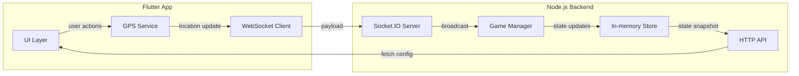

# Real‑World GPS Battle Royale (Free Fire‑style)

## Overview
This repository contains a starter codebase to build a **real‑life, GPS‑based battle‑royale** game where players move in the physical world and fight using their smartphones – similar to the popular mobile game **Free Fire**.

- **Cross‑platform**: Flutter (Android, iOS, Desktop) for the client UI.
- **Backend**: Node.js + Express + Socket.IO for real‑time location & combat sync.
- **Core features** (initial MVP):
  1. Player registration & authentication (simple UUID for demo).
  2. GPS location streaming (≈ 5 s interval).
  3. Real‑time map showing all players (Google Maps).
  4. “Shoot” action when another player is within a configurable radius.
  5. Health/kill logic & match timer.
  6. Simple lobby → match start flow.

The codebase is intentionally minimal – you can expand it with richer character abilities, matchmaking, cloud‑hosted services, etc.

---
## Folder layout
```
freefire  game/
├─ README.md                # (this file)
├─ backend/                 # Node.js server
│   ├─ package.json
│   ├─ server.js
│   └─ models/              # game‑state models (in‑memory for MVP)
├─ frontend/                # Flutter client
│   ├─ pubspec.yaml
│   └─ lib/
│       └─ main.dart
└─ docs/
    └─ architecture.md      # description of components & data flow
```
---
## Quick start (local development)
### Prerequisites
- **Node ≥ 20** and **npm**
- **Flutter ≥ 3.19** (with Android SDK / Xcode for mobile builds)
- Google Maps API key (for map view) – add to `frontend/android/app/src/main/AndroidManifest.xml` and iOS plist.

### Backend
```bash
cd "freefire  game/backend"
npm install
node server.js   # runs on http://localhost:3000
```
The server uses in‑memory storage; for production replace with Redis / database.

### Frontend
```bash
cd "freefire  game/frontend"
flutter pub get
flutter run       # runs on attached device/emulator
```
The app will request location permission, connect to the backend via WebSocket, and display nearby players.
---
## Architecture (high‑level)

---
## Next steps & extensions
- **Authentication**: OAuth2 / Firebase Auth.
- **Persistent storage**: Redis, PostgreSQL.
- **Scalable matchmaking**: Kubernetes, autoscaling.
- **Game balance**: weapons, health, safe‑zone shrinking.
- **Anti‑cheat**: server‑side validation of GPS jitter, speed limits.
- **Analytics**: player stats, heatmaps.
- **Deploy**: Dockerize backend, CI/CD pipelines.

---
## License
MIT – feel free to fork, modify, and publish!
